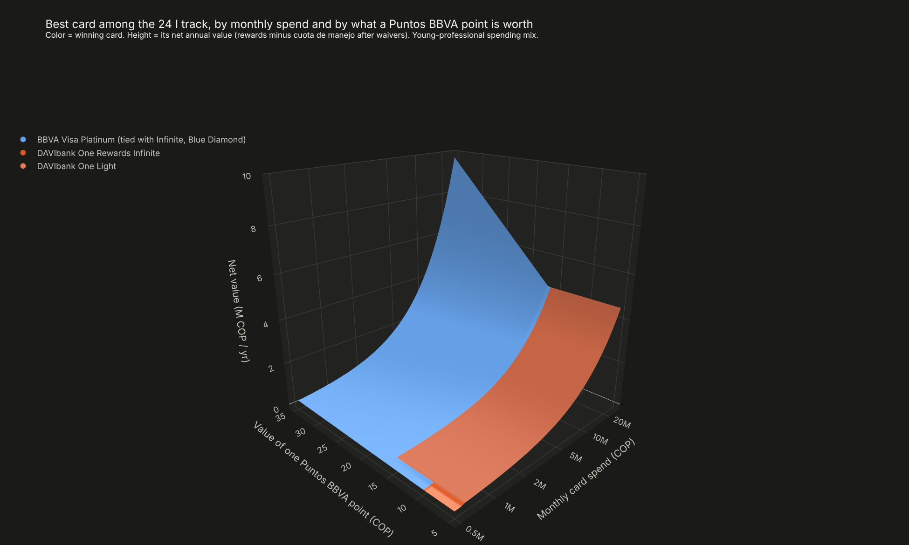
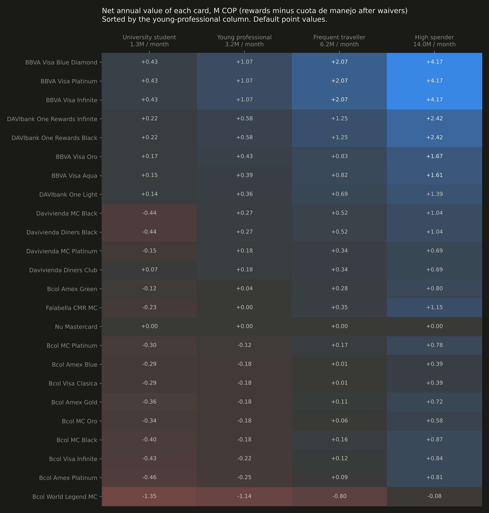
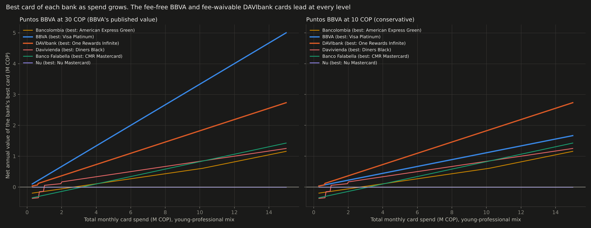
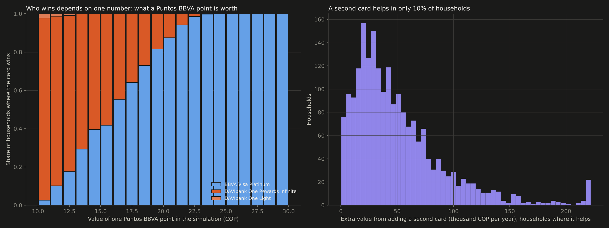

# Credit Card Rewards Optimizer

Which of the credit cards I track gives me the most value for the way I spend?

I keep one spreadsheet per bank, with one tab per product. Those spreadsheets list 24 credit cards across Bancolombia, BBVA, DAVIbank, Davivienda, Banco Falabella and Nu. This project values every one of them in pesos (points earned times what a point is worth, minus the cuota de manejo after any waiver) and finds the best card and the best two-card wallet for a given spending profile. The spending categories are the same ones I use to track my own expenses.

The project has three parts:
- a reusable model;
- a Monte Carlo study of 20,000 simulated households with uncertain point values;
- an interactive calculator (`dashboard.html`) where you type a monthly budget, tick the cards you want to consider, and get the ranking, the best wallet and which card to use in each category.

All numbers come from outputs/metrics.json.



## Key findings

**1. At the default point values, BBVA's 3-points-per-dollar cards win every profile.** The Visa Platinum, Visa Infinite and Blue Diamond have no cuota de manejo for cards issued since March 2026. At 30 COP per point they return about 2.8% on everything except taxes, so they tie for first.

| Profile | Monthly spend | Best card | Value / year | Best DAVIbank card | Best Bancolombia card |
|---|---|---|---|---|---|
| University student | 1.3M | BBVA Platinum / Infinite / Blue Diamond | 433,333 | One Rewards Infinite, 224,444 | Amex Green, -115,975 |
| Young professional | 3.2M | BBVA Platinum / Infinite / Blue Diamond | 1,066,667 | One Rewards Infinite, 583,333 | Amex Green, 38,896 |
| Frequent traveller | 6.2M | BBVA Platinum / Infinite / Blue Diamond | 2,066,667 | One Rewards Infinite, 1,250,000 | Amex Green, 283,429 |
| High spender | 14.0M | BBVA Platinum / Infinite / Blue Diamond | 4,166,667 | One Rewards Infinite, 2,416,667 | Mastercard Black, 872,730 |

**2. That ranking depends on one uncertain number.** BBVA sets the value of a point when you redeem it. The only peso value it publishes is 30 COP, and that figure comes from its business loyalty rules.
- BBVA stays the best card as long as a point is worth more than 15.5 to 18.1 COP, depending on the profile.
- Below that, DAVIbank One Rewards Infinite wins every profile. It earns 3 points per dollar (more on travel and USD purchases), and its 55,730 COP fee is waived with 10 purchases a month.
- In the Monte Carlo study, BBVA wins:

| Value of a BBVA point | BBVA wins in |
|---|---|
| 25 to 30 COP | 100% of households |
| 20 to 25 COP | 96% |
| 15 to 20 COP | 63% |
| 10 to 15 COP | 20% |

**3. Fee waivers matter more than earn rates.** Every winner is a card that has no cuota de manejo or whose fee is waived by usage:
- BBVA's 0 COP cards win 70% of the 20,000 households.
- DAVIbank One Rewards Infinite wins 30%.
- DAVIbank One Light wins 0.2%.

**4. None of the 10 Bancolombia cards ever wins.** Their Puntos Colombia return between 0.5% and 0.95%, with no fee waiver.
- For the student all 10 lose money, and for the young professional 9 of the 10 do.
- The World Legend (125,000 COP a month) loses money in every profile.

The four Davivienda cards and the CMR also never win.

**5. A second card rarely helps.** Once the best card earns a flat rate on everything, a second card adds value in only 10% of households. In those households the median gain is about 40,000 COP a year.

## Charts

| | |
|---|---|
|  |  |
|  | Interactive versions in `dashboard.html` |

- `01_best_card_surface_3d.html` is a 3D surface of monthly spend against the value of a BBVA point. Color shows the winning card and height shows its net annual value.
- `02_cards_by_profile.png` is a heatmap of the net value of all 24 cards for the four profiles.
- `03_best_card_per_bank.png` shows the best card of each bank as spend grows, at 30 and at 10 COP per BBVA point.
- `04_monte_carlo.png` shows the winner by BBVA point value and the extra value from a second card.
- `dashboard.html` is the calculator. It includes:
  - a monthly budget by category and an average purchase size (used for purchase-count waivers);
  - an editable value for each points program, plus the TRM;
  - a checkbox for each of the 24 cards, so you can restrict the comparison to the cards you actually hold;
  - the ranking, the best two-card wallet with the card to use in each category, and the best card of each bank as spend grows.

## Data

`data/cards.csv` has 24 cards with their published earn rates, fees and fee-waiver rules, and one source URL per card. `data/README.md` explains the units and the point values.

14 cards have at least one assumed value, flagged in the `assumed` column. The main assumptions are:
- the Puntos Colombia earn rate of some Bancolombia Mastercard and Visa cards, mapped to the American Express tier with the same rank;
- the One Rewards Black earn rate, assumed equal to the Infinite;
- the Davivienda fees, which come from the last published tariff.

Default point values (COP per point):

| Program | Value |
|---|---|
| Puntos Colombia | 6 |
| Puntos BBVA | 30 |
| Davipuntos | 15 |
| DAVIbank One Rewards | 15 |
| CMR Puntos | 19.2 |

The TRM is 3,240 COP per US dollar.

## Method

For every card *k* and spending category *c*:

```
points[k, c] = spend[c] * earn[k, c] / TRM          (programs that earn per US dollar)
points[k, c] = spend[c] * earn[k, c] / 1000         (programs that earn per 1,000 COP)
net_annual_value[k] = 12 * sum_c points[k, c] * value_of_point[k] - annual_fee_after_waiver[k]
```

Fee waivers are modeled from each bank's rules:
- **DAVIbank:** the fee is waived with 10 purchases a month. The purchase count is monthly spend divided by the average purchase size.
- **Davivienda:** the fee is waived fully above a monthly billing threshold and half waived between the partial and the full threshold.

The two-card optimizer tests all 276 pairs. Each category goes to the card that pays more, and each card's waiver is checked against the spend it actually receives.

The Monte Carlo study draws 20,000 households:
- total monthly spend is log-normal with a median of 3M COP;
- the category mix is random;
- point values and the average purchase size are uniform within the ranges stored in metrics.json.

## Limitations

The model does not include:
- income requirements and approval (a Blue Diamond or an Infinite is not available to everyone);
- introductory free months, welcome bonuses and temporary promotions such as double points;
- interest, because every value assumes the balance is paid in full;
- benefits that are not points, such as VIP lounges, insurance and discounts.

Point values are what a point buys at redemption, not cash, and banks can change them.

## Project structure

```
data/cards.csv          24 cards, earn rates, fees, waiver rules, sources, assumptions
src/model.py            valuation, fee waivers, two-card optimizer, break-even point value
main.py                 profiles, Monte Carlo, writes outputs/
charts.py               3D surface, static charts and dashboard.html
tests/test_model.py     unit tests
outputs/                charts, metrics.json, persona_values.csv, simulations.csv.gz
```

## How to run

```
pip install -r requirements.txt
python main.py
pytest -q
```

Open `dashboard.html` in a browser for the calculator.

## Development process and use of AI

I designed this project and made the decisions:
- using the cards from my own bank spreadsheets and my own expense categories;
- turning every program into pesos per peso spent;
- modeling fee waivers instead of headline fees;
- treating the value of a point as the main uncertainty and testing it with Monte Carlo.

I used AI as a working partner for the hardest parts. It helped me brainstorm the analysis, research and cross-check the published card conditions, vectorize the simulation, and speed up writing the charts and the dashboard. I reviewed the results, checked the conditions against their sources and decided what to report.
